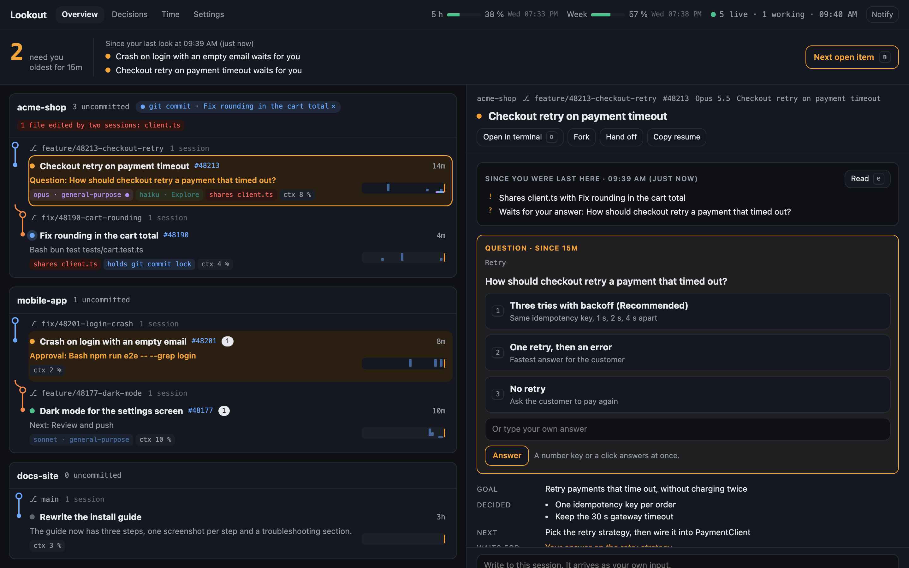
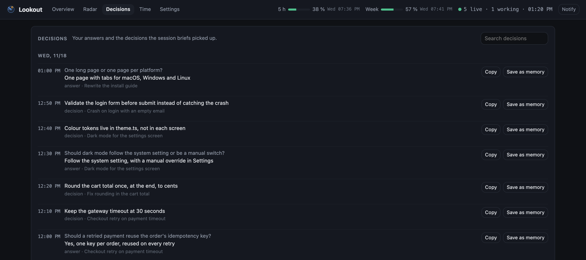
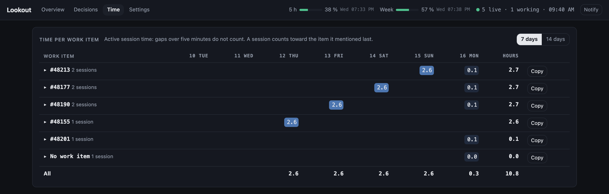
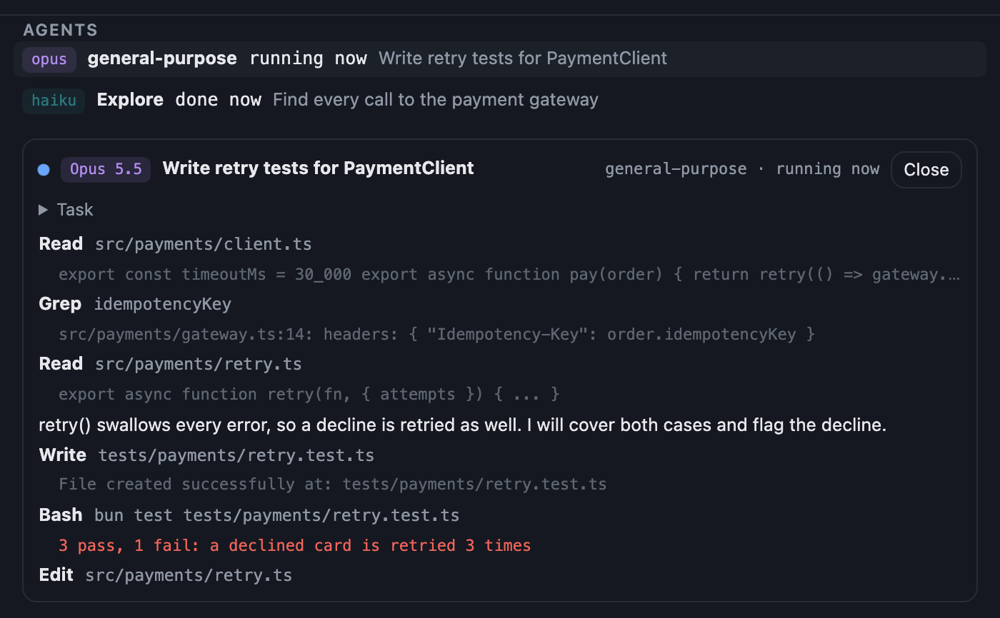
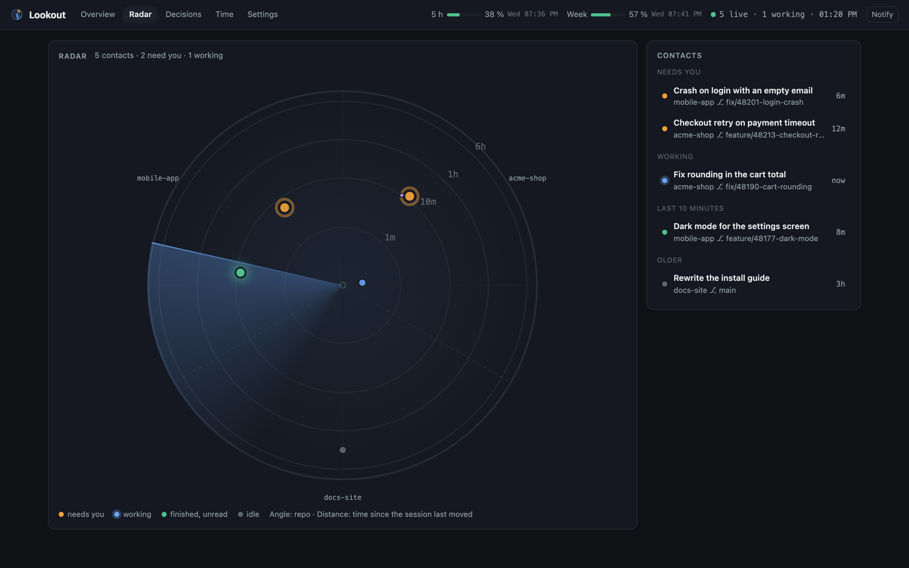
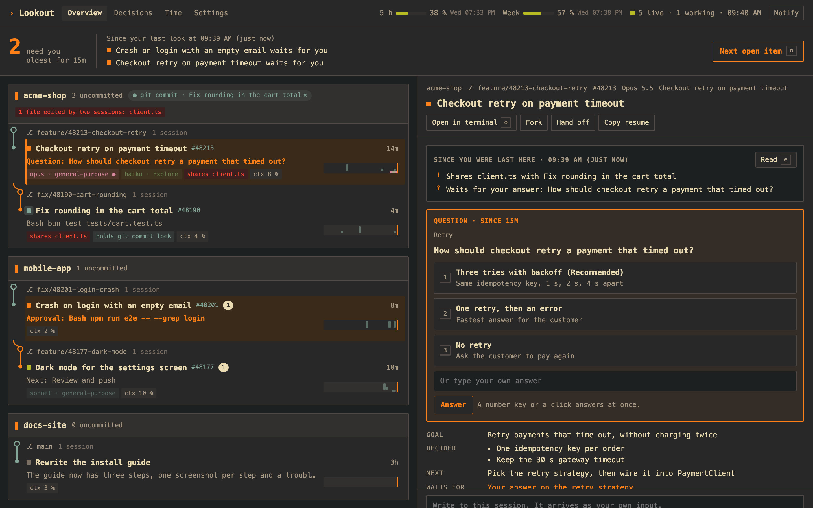
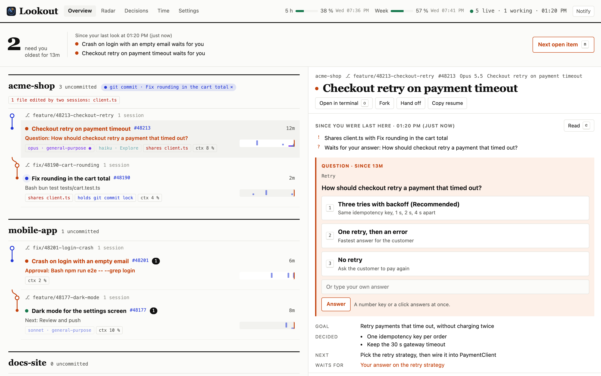
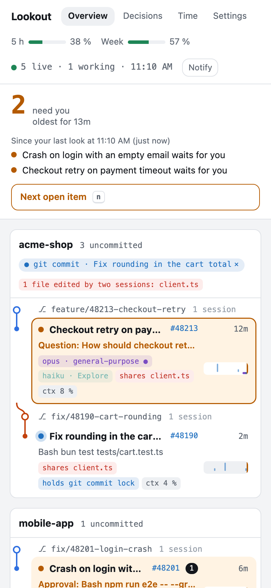
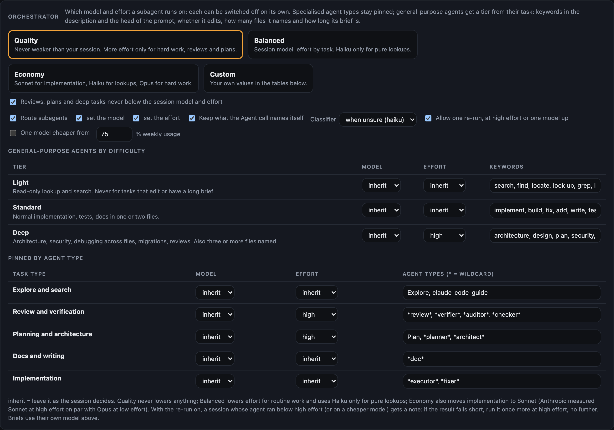

# Lookout

Run many Claude Code sessions as one. Lookout shows every live session on your machine in one place: which ones need you, what happened while you were away, and where two sessions are about to step on each other. Answer a question in any session without switching windows, and let subagents run on the model their task needs.

It works in the terminal, in Claude Desktop and on a local web page, on macOS and Windows.



*All screenshots use invented sample data.*

## What you get

- **One overview.** Every live session, grouped by repository and branch, with its status, its open question or approval, unread replies, recent activity, running agents and context fill.
- **Radar.** Every session as a blip: the angle is its repository, the distance how long ago it last moved. Sessions that need you pulse, running agents circle their session, the sweep lights up each blip it passes. The browser tab's icon counts the sessions that need you.
- **See what an agent does.** Click a subagent and follow it live: its task, each tool call and what came back.
- **Jump to a session.** "Open" brings the session's own terminal tab to the front (macOS: Ghostty, Terminal, iTerm; Windows: Windows Terminal).
- **Answer from one place.** Pick an option with a number key, type your own answer or write to a session. It arrives as your own input.
- **Catch-up.** "Since your last look" lists commits, finished agents, compactions and files two sessions share. A recap appears above the prompt when you return to a session.
- **Session briefs.** Goal, decisions, next step and blocker for every session, written by a small model after each turn and handed back after compaction. The session's goal and next step stay pinned above the prompt (switch off in Settings: "Brief pinned above the prompt").
- **Decision log.** Every answered question and decision, searchable, one click to save as memory.
- **No collisions.** A warning when two sessions edit the same file, and `git commit` and integration tests wait while another session holds them.
- **Limits.** 5-hour and weekly usage with reset times, and a guard that stops new subagents above a weekly threshold.
- **Model routing for subagents.** Off by default, and quality first when on. See [Orchestrator](#orchestrator).
- **Time per work item.** Active hours per ticket, from the ticket numbers in prompts and branch names.
- **Status line and git pane** in the terminal.

| Decisions | Time |
|---|---|
|  |  |





## Requirements

- Claude Code with mods (function hooks).
- [Bun](https://bun.sh) on your PATH. The collector and the local web server run on Bun.
- macOS or Windows.

## Install

In a Claude Code session:

```
/plugin marketplace add martin112211/lookout
/plugin install lookout@lookout
```

From a shell: `claude plugin marketplace add martin112211/lookout`, then `claude plugin install lookout@lookout`. In Claude Desktop: the + next to the prompt box, Plugins, Add marketplace, then add Lookout.

Start a new session afterwards. Lookout begins collecting as soon as one session runs it.

## Quick start

| Command | What it opens |
|---|---|
| `/lookout` | Sessions pane: all live sessions, their open items and briefs |
| `/lookout ask` | Open questions of the other sessions, answerable inline |
| `/lookout recap` | What happened in this session since your last input |
| `/lookout settings` | Feature switches and the orchestrator |
| `/lookout-web` | The web page, served on 127.0.0.1:47821 |
| `/git` | Changed files with line bars and the recent commit graph |

Keys on the web page: `j` and `k` select, `n` next open item, `1` to `9` answer, `r` write, `o` open in the terminal, `e` mark read, `?` diff. Click an agent (or its chip on a card) to follow it. In the pane: `n`, `j`, `k`, `1` to `9`, `o` open, `a` next agent, `b` browser.

## Where it runs

| | Terminal | Claude Desktop | Web page |
|---|---|---|---|
| Overview and answers | `/lookout` pane | same pane | Overview tab |
| Radar | | | Radar tab |
| Recap | band above the prompt | band above the prompt | catch-up list |
| Brief | pinned above the prompt | pinned above the prompt | focus panel |
| Agent live view | `/lookout` pane, `a` | same pane | click an agent or its chip |
| Decisions, Time | | | own tabs |
| Settings | `/lookout settings` | `/lookout settings` | Settings tab, all values |
| Status line, `/git` | yes | yes | |

"Open in terminal" switches to the tab the session already runs in. "Fork" opens a copy of the session in a new tab or window. Which terminals support what:

| Terminal | Open (switch to the session's tab) | Fork (new tab or window) |
|---|---|---|
| Ghostty 1.3 or later (macOS) | yes, found by tab title, else by folder | new Ghostty window |
| Terminal (macOS) | yes, found by the session's terminal device | new Terminal window |
| iTerm2 (macOS) | yes, found by the session's terminal device | new Terminal window |
| Windows Terminal | yes, found by tab title through UI Automation in PowerShell | new Windows Terminal tab |
| WezTerm, kitty, Alacritty, Warp, the VS Code terminal (macOS) | no: Lookout names the tab to switch to | new Terminal window |
| Other Windows terminals (VS Code, ConEmu, a plain console window) | no: Lookout names the tab to switch to | new Windows Terminal tab, if Windows Terminal is installed |

- On macOS, the first "Open" asks you to allow Automation (Privacy & Security). Without it, Lookout names the tab instead.
- Open finds a tab by its title only while the terminal shows the title Claude Code sets. With title changes switched off (in Windows Terminal: "Suppress title changes"), Lookout names the tab instead.
- A background session (`claude --bg`) opens with `claude attach` in a new tab or window, as Fork does.

The web page has three looks, each light and dark, and works at phone width.

| Warm | Editorial | Phone |
|---|---|---|
|  |  |  |

## Orchestrator

Lookout can set the model and effort a subagent runs on. It ships switched off. Switched on, it starts on the Quality profile, which never makes an agent weaker than your session.



| Profile | Lookups | Implementation | Hard work, reviews, plans |
|---|---|---|---|
| **Quality** (default) | session model and effort | session model and effort | session model, effort raised to high |
| Balanced | Haiku, low effort | session model, medium effort | session model, high effort |
| Economy | Haiku, low effort | Sonnet, high effort | Opus, high effort |

Any value can be changed by hand; the profile then reads Custom.

- **Protection** (on by default): reviews, plans and hard tasks never run below the session's model or effort, in any profile, and the budget downgrade leaves them alone. If the session's model is unknown, they keep it.
- **How a task is judged.** Specialised agent types are pinned (`Explore`, reviewers, `Plan`, docs, executors; `*` is a wildcard). `general-purpose` agents get a tier from their task: keywords in the description and the start of the prompt, judgment words such as verify, compare or recommend, whether the task edits, how many files it names and how long its brief is.
- **Haiku only for pure lookups.** A task that edits, analyses, summarises or has a long brief never goes to the light tier, not even when the classifier says so.
- **Classifier.** When the signals are unclear, a short Haiku call picks the tier. It may not lower a task the keywords found hard.
- **Your choice wins.** An explicit `model` or `effort` in the Agent call is kept, and forks always keep the parent's.
- **One re-run.** When an agent ran below high effort, the session gets a note: if the result falls short, run it once more at high effort or one model up, and no further.
- **Measured.** Every decision with its reasons and every agent's outcome (model that ran, tokens, time) goes to `~/.claude/lookout/routing.jsonl` and the Settings page. Replay applies the current rules to your agent calls of the last 7 to 30 days and shows how often each model's tasks had to be redone.

The profiles follow Anthropic's published measurements in *Optimizing for cost and intelligence*:
- Sonnet 5.5 at high effort and Opus 5.5 at low effort solve about the same share of coding tasks at about the same cost.
- Haiku subagents fall well behind on analysis and code.
- Lowering effort on the same model is the first lever to try.

Usage limits are shared across all models; only Fable has its own weekly limit on Max and Ultra.

## Integrations

Lookout bundles no other mod. When one of these is installed, Lookout uses it; each use is a switch in Settings.

| Mod | What Lookout does with it |
|---|---|
| skins | The status line takes the active skin's colours, light and dark. Without skins: a built-in gruvbox palette. |
| cache-tax | Its status text moves into Lookout's status line instead of a line of its own. |

## Your data

Everything stays on your machine. The one exception is the update check, which is off until you switch it on.

- Lookout reads the session files Claude Code already writes under `~/.claude` and keeps its own state in `~/.claude/lookout`.
- The web server listens on 127.0.0.1 only and needs a token. The page loads nothing from the internet.
- Two features call a model through your own Claude account and count toward your usage: session briefs and the routing classifier. Both use Haiku by default, and both can be switched off.
- Messages from the page to a session are signed with a per-machine key and expire after 5 minutes. Permission prompts are shown read-only and cannot be approved from the page.

What Lookout runs on your machine:

- **Bun** runs the collector (`scripts/collect.mjs`), which reads the session and transcript files, and the local web server (`scripts/server.mjs`), started by `/lookout-web` or the first session that needs it. The server runs in a process of its own and keeps running after that session ends; its output goes to `~/.claude/lookout/server.log`. After a plugin update the first session with the new version replaces an older running server.
- **git** reads status, branches, recent commits and diffs for the status line, `/git`, the repo cards and "Show diff". Lookout never commits or pushes on its own; "Commit" on the page sends the session a request to do it.
- **ps** reads the terminal device and terminal app of a session's process, so "Open" can find its tab. **uname** tells macOS from Linux.
- **osascript** (macOS only) brings a session's Ghostty, Terminal or iTerm tab to the front when you press "Open", opens a Terminal window for "Fork", and brings the terminal forward from the page. macOS asks you to allow this under Privacy & Security, Automation.
- **powershell.exe** (Windows only) finds a session's Windows Terminal tab by its title with UI Automation, selects it and brings its window to the front when you press "Open".
- **Terminal and browser openers**: `open` (macOS), `wt` (Windows Terminal) or `x-terminal-emulator` start a new tab for "Fork" and "Attach"; `open`, `rundll32` or `xdg-open` open the web page in your browser.
- Network: the hooks talk only to Lookout's own server on 127.0.0.1. The only requests that leave your machine are the two optional model calls above, made through Claude Code, and, when you switch on "Check for a new Lookout version" (off by default), one `git ls-remote --tags` a day against the repository Lookout was installed from. That request reads the list of release tags and sends nothing about you or your sessions. A newer version then shows in the status line and on the page.

| Path | Content | Copy to a new machine? |
|---|---|---|
| `~/.claude/lookout/config.json` | your settings | yes |
| `~/.claude/lookout/ledger/` | decision log | optional |
| `~/.claude/lookout/briefs/`, `usage/`, `touches/`, `pending/`, `leases.json`, `reads.json`, `summary.json`, `titles.json`, `routing.jsonl` | live state, rebuilt automatically | no |
| `~/.claude/lookout/update.json`, `server.log` | result of the last update check, server output | no |
| `~/.claude/lookout/relay.key`, `server.json` | per-machine key and server token | never |

## What the hooks do

Lookout is a mod: TypeScript hooks in `hooks/` that Claude Code runs in every session. Each hook, what it decides and what it changes:

| Hook | When | What it does |
|---|---|---|
| `tool.call` on `AskUserQuestion` | Claude asks you a question | Records the open question in `~/.claude/lookout/pending/` so the page and the pane can show it. With "Answer from Lookout" on, it waits for the terminal dialog and for an answer from the page or pane, whichever comes first; an answer from Lookout is returned in place of the dialog's result, in the same shape. Off: the dialog runs alone. |
| `tool.call` on `ExitPlanMode` | a plan waits for approval | Records that a plan waits. The call and its result stay unchanged. |
| `classic.PermissionRequest` | a permission prompt appears | Records the prompt so the page can show it read-only. The decision stays yours, in the terminal. |
| `tool.call` (every tool) | after each tool call | Refreshes the status line and the git pane. After `Edit`, `Write` and `NotebookEdit` it records the edited file; when another live session edited the same file within the radar window, it adds a one-line note to the tool result for Claude. Input and result are otherwise unchanged. |
| `tool.call` on `Bash` and `PowerShell` | the command is `git commit` or an integration test run | Waits up to `waitMin` minutes (default 15) while another session holds that lock, then runs the command unchanged, and adds a note when it waited. It never changes or refuses a command. |
| `agent.spawn` | a subagent is about to start | Budget guard: when your weekly usage is at or above the threshold (default 90 %), it refuses the new subagent with a message asking Claude to report instead. Switch "Budget guard" off to never refuse. |
| `classic.PreToolUse` | before each tool call | Reads the session's effort level for the orchestrator. Changes nothing. |
| `tool.call` on `Agent` | Claude starts a subagent | Orchestrator, off by default: may set `model` and `effort` on the Agent call, by the rules under [Orchestrator](#orchestrator). It never changes the prompt, the agent type or any other field, keeps an explicit `model` or `effort` (while "Keep what the Agent call names itself" is on, the default), and leaves forks alone. After the run it logs the outcome and may add one note suggesting a single re-run. |
| `turn.complete` | a turn ends | Updates the status line and usage file, writes the session brief (a model call, see below) and logs background agents' outcomes. |
| `classic.SessionStart` | after a compaction | Adds the session brief to the new context. |
| `session.receive` | another session sends a message | Only a message signed with this machine's Lookout key (`relay.key`, at most 5 minutes old) is submitted as your own prompt; that is how text from the page reaches a session. Every other message passes unchanged. |
| `prompt.submit` | you send a prompt | Hides the recap band. Your prompt passes unchanged. |
| `ui.status` | cache-tax sets its status text | With the cache-tax switch on, takes that text into Lookout's status line. |
| `ui.render` | drawing | Draws the panes (`/lookout`, `/lookout ask`, `/lookout settings`, `/git`), the band above the prompt (pinned brief, recap) and the status line under the prompt, which replaces that line. It never draws the `AskUserQuestion` dialog. |
| `command.run` | `/lookout`, `/lookout-web`, `/git` | Opens the panes or the web page. |
| `session.start` | a session starts | Starts the timers (collector every few seconds, usage every minute, the update check every hour, which asks the network at most once a day and only when switched on), moves data once from an old `~/.claude/hub` or `~/.claude/docket` folder, loads the brief. |

### What Lookout puts in prompts

- **Session brief:** a fixed instruction (in `hooks/hub.tsx`), the previous brief and this session's last 16 messages, each cut to 1,500 characters, sent through Claude Code to the brief model (Haiku by default), at most once per turn and per `everySec`.
- **Routing classifier:** the subagent's description and the first 2,500 characters of its prompt, sent through Claude Code to Haiku, which answers with one tier.
- **Messages from the page:** the text you type, delivered as your own input to the session you picked. A hand-off adds the source session's brief and latest answer. "Commit" sends the fixed request "Looks good. Commit your changes now: only your own hunks, in the commit style of this repository."
- **Notes for Claude:** the one-line notes above (shared file, lock wait, re-run) and the budget guard's refusal text.

### What Lookout writes

Only files under `~/.claude/lookout` (see the table above), including `config.json`, which changes only when you change a setting. It never writes to your repositories, to Claude Code's settings, to `CLAUDE.md` or to the session files it reads.

### Hosts and values it reads

- The hooks call only `http://127.0.0.1:<port>`, Lookout's own server (port 47821 unless taken), and send the token from `~/.claude/lookout/server.json` in the `x-lookout-token` header. Lookout creates that token on your machine; it is no credential of another service.
- With the update check on, `git ls-remote` asks the repository Lookout was installed from: the GitHub repository of the `lookout` marketplace in `~/.claude/plugins/known_marketplaces.json`, or the `origin` of the plugin folder when it is loaded from a clone. Only `https` sources are asked.
- From the environment it reads `HOME` or `USERPROFILE` (to find `~/.claude`) and `TERM_PROGRAM` (which terminal app to open or switch to). Neither leaves your machine.

## Settings

One file, `~/.claude/lookout/config.json`, read by every session within 10 seconds. Change it with `/lookout settings` (switches and models) or on the Settings tab (everything, including numbers, agent types and keywords). Missing or invalid values fall back to the defaults in `hooks/settings.ts`.

## Development

Run from a clone: add the folder to `CLAUDE_CODE_PLUGIN_DIRS` in `~/.claude/settings.json` (`;` between folders on Windows, `:` on macOS) and start a new session.

```
claude plugin validate .      # engine checks
claude plugin test .          # tests
bunx tsc -p .                 # type-check
```

After changing `scripts/server.mjs`, `scripts/hub-data.mjs` or `hooks/settings.ts`, restart the server: end the process whose pid is in `~/.claude/lookout/server.json`, then run `/lookout-web`.

## Credits

The built-in skin palettes in `hooks/palettes.ts` come from the skins mod by hellosverre (MIT), see `NOTICE`.

## License

MIT, see `LICENSE`.
